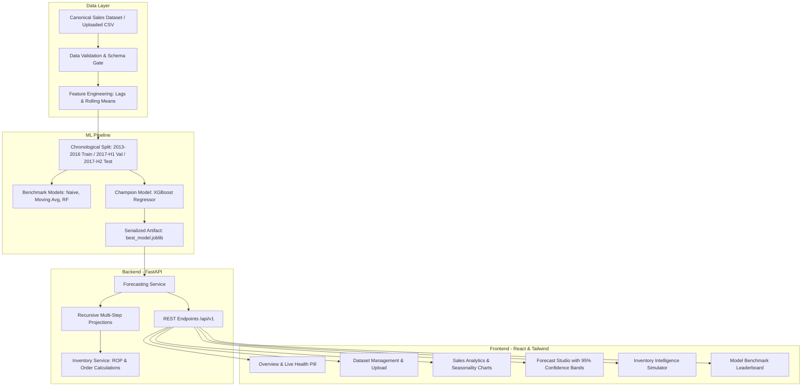

# DemandSense AI

> **Production-Grade Retail Demand Forecasting & Inventory Intelligence Platform**

[](https://fastapi.tiangolo.com)
[](https://react.dev)
[](https://www.typescriptlang.org)
[](https://vitejs.dev)
[](https://xgboost.readthedocs.io)
[](LICENSE)

DemandSense AI is an end-to-end retail intelligence application that leverages leakage-safe gradient boosting to forecast future SKU sales and compute transparent, mathematically grounded inventory replenishment recommendations.

---

## Table of Contents

- [Key Features](#key-features)
- [System Architecture](#system-architecture)
- [Visual Overview](#visual-overview)
- [Tech Stack](#tech-stack)
- [Dataset & Schema](#dataset--schema)
- [Machine Learning Pipeline](#machine-learning-pipeline)
- [Model Evaluation & Leaderboard](#model-evaluation--leaderboard)
- [REST API Reference](#rest-api-reference)
- [Quickstart: Local Development](#quickstart-local-development)
- [Automated Testing](#automated-testing)
- [Production Deployment](#production-deployment)
- [Limitations & Operational Scope](#limitations--operational-scope)
- [License](#license)

---

## Key Features

1. **Live Analytics & Seasonality Profiling:** Explores multi-year historical unit volume across 10 retail stores and 50 SKUs with day-of-week seasonality distributions.
2. **Recursive Multi-Step Demand Projections:** Generates 7-, 14-, and 30-day ahead demand trajectories with dynamic 95% confidence intervals and historical context continuity.
3. **Automated CSV Forecast Export:** Downloads projected daily unit forecasts formatted directly for ERP and spreadsheet ingestion.
4. **Transparent Inventory Replenishment Simulator:** Calculates Reorder Points (ROP) and Suggested Order Quantities based on dynamic model lead-time demand, user-configured on-hand stock, lead times, and parameterized safety buffers.
5. **Strict Zero-Leakage ML Engineering:** Features lag ($t-1, t-7, t-14, t-28$) and shifted rolling window statistics ($7\text{d}, 28\text{d}$), preserving strict causality without future data leakage.
6. **Canonical Ingestion & Schema Gate:** Accepts custom user CSV uploads, enforcing 4 required columns (`date`, `store`, `item`, `sales`), non-negativity, date parsing, and duplicate rejection.
7. **Production Benchmark Leaderboard:** Features interactive model comparisons (XGBoost vs Random Forest vs Baselines) evaluated on a strict chronological holdout split.

---

## System Architecture



---

## Visual Overview

The platform features 7 dedicated, fully responsive dashboard modules:

| Dashboard View | Primary Capabilities |
| :--- | :--- |
| **Overview** | Live dataset profile stats, production XGBoost model status, holdout MAE/WAPE pills, and pipeline action triggers. |
| **Dataset Management** | Drag-and-drop CSV upload, live schema validation checks, error/warning diagnosis, and canonical dataset profiling. |
| **Sales Analytics** | Store & SKU dropdown selectors, 30/90/180/365-day time-series windowing, and Recharts day-of-week seasonality bar charts. |
| **Forecast Studio** | 7/14/30-day projection selectors, combined 14-day history + forecast chart, 95% confidence bands, and CSV export. |
| **Inventory Insights** | Interactive replenishment simulator: On-hand, lead time, incoming stock, and safety buffer % calculating live ROP and suggested orders. |
| **Model Performance** | Leaderboard comparing XGBoost against Random Forest, 7d Rolling Mean, and Naive baselines with split dates and limitations. |
| **Settings / About** | Real-time backend connectivity diagnostics, configured base URL, runtime environment, and operational boundaries. |

---

## Tech Stack

- **Backend:** Python 3.11+, FastAPI, Pydantic v2, Uvicorn, Pytest, HTTPX, Joblib
- **Frontend:** React 18, TypeScript 5.6, Vite 5.4, Tailwind CSS, Recharts, Lucide React
- **Machine Learning & Preprocessing:** Scikit-learn, XGBoost, Pandas, NumPy
- **Deployment:** Render (FastAPI Web Service), Vercel (Vite React SPA)

---

## Dataset & Schema

The canonical demonstration dataset is structured around the **Kaggle Store Item Demand Forecasting Challenge** (5 years of daily store-item observations, 913,000 rows):

| Column | Type | Constraints | Description |
| :--- | :--- | :--- | :--- |
| `date` | String / ISO Date | Format `YYYY-MM-DD` | Timestamp of observed store sales |
| `store` | Integer | $\ge 1$ | Store identifier integer |
| `item` | Integer | $\ge 1$ | Product SKU identifier integer |
| `sales` | Float / Integer | $\ge 0$ | Units sold on date at store |

> **Redistribution Policy:** Raw Kaggle dataset files and large processed CSVs are excluded from Git commits via `.gitignore`. The repository includes a lightweight demonstration seed dataset (`ml/data/seed_sales.csv`) allowing immediate out-of-the-box local and cloud deployment.

---

## Machine Learning Pipeline

### Feature Engineering (`ml/features/engineer.py`)
- **Calendar Signals:** `day_of_week`, `day_of_month`, `month`, `year`, `week_of_year`, `is_weekend`.
- **Lag Features:** $t-1$, $t-7$, $t-14$, $t-28$.
- **Rolling Windows:** 7-day rolling mean, 7-day rolling standard deviation, and 28-day rolling mean.
- **Zero Leakage Protocol:** All rolling windows are strictly shifted by 1 observation before aggregation to guarantee zero future data leaks.

### Chronological Splits
- **Training Set:** `2013-01-01` to `2016-12-31` (4.0 years, 730,500 records)
- **Validation Set:** `2017-01-01` to `2017-06-30` (6.0 months, 90,500 records)
- **Holdout Test Set:** `2017-07-01` to `2017-12-31` (6.0 months, 92,000 records)

---

## Model Evaluation & Leaderboard

The champion model selected for production inference is **XGBoost**:

| Model Architecture | Validation MAE | Test MAE | Test RMSE | Test WAPE | Test sMAPE | Status |
| :--- | :---: | :---: | :---: | :---: | :---: | :---: |
| **XGBoost Regressor** | **6.016** | **6.340** | **8.240** | **10.33%** | **11.90%** | **Production Selected** |
| Random Forest | 6.133 | 6.531 | 8.499 | 10.64% | 12.22% | Benchmark Candidate |
| Rolling Mean (7d) | 8.626 | 9.328 | 12.289 | 15.19% | 16.47% | Statistical Baseline |
| Seasonal Naive (Lag 7)| 8.463 | 9.214 | 12.114 | 15.01% | 17.04% | Statistical Baseline |
| Naive (Lag 1) | 10.894 | 11.590 | 15.863 | 18.88% | 20.70% | Statistical Baseline |

---

## REST API Reference

| Endpoint | Method | Description |
| :--- | :--- | :--- |
| `/health` | `GET` | Health status and runtime service diagnostics |
| `/api/v1/datasets/schema` | `GET` | Required column names, descriptions, and file-size constraints |
| `/api/v1/datasets/validate` | `POST` | Validates an uploaded CSV file without committing to storage |
| `/api/v1/datasets/upload` | `POST` | Ingests and validates a user CSV dataset |
| `/api/v1/analytics/summary` | `GET` | Summary statistics and day-of-week seasonality metrics |
| `/api/v1/analytics/series` | `GET` | Unique store and item IDs available |
| `/api/v1/analytics/history` | `GET` | Historical daily sales observations for a store/item series |
| `/api/v1/forecast` | `POST` | Multi-step recursive demand forecast (7, 14, or 30 days) |
| `/api/v1/forecast/export` | `POST` | Exports projected daily demand directly as a downloadable CSV file |
| `/api/v1/inventory/recommendation` | `POST` | Reorder Point (ROP) & suggested order quantity calculation |
| `/api/v1/model/info` | `GET` | Production model metadata, benchmark leaderboard, and limitations |

---

## Quickstart: Local Development

### Prerequisites
- Python 3.11+
- Node.js 18+ and npm

### 1. Clone & Set Up Backend

```bash
git clone https://github.com/your-username/DemandSenseAI.git
cd DemandSenseAI

# Create virtual environment
python -m venv .venv

# Activate virtual environment
# Windows:
.venv\Scripts\activate
# macOS/Linux:
source .venv/bin/activate

# Install backend dependencies
pip install -r backend/requirements.txt

# Start FastAPI server
uvicorn app.main:app --app-dir backend --reload --port 8000
```
- API Docs: [http://localhost:8000/docs](http://localhost:8000/docs)
- Health Probe: [http://localhost:8000/health](http://localhost:8000/health)

### 2. Set Up Frontend

```bash
# In a new terminal tab, navigate to frontend
cd frontend

# Install dependencies
npm install

# Start Vite development server
npm run dev
```
- Frontend Dashboard: [http://localhost:5173](http://localhost:5173)

---

## Automated Testing

```bash
# Run backend test suite (42 unit and E2E integration tests)
pytest backend/tests

# Run frontend test suite (8 logic and formula validation tests)
npm test --prefix frontend

# Verify frontend production build
npm run build --prefix frontend
```

---

## Production Deployment

### Option A: Render (Backend) + Vercel (Frontend)

1. **Deploy Backend on Render:**
   - Create a new **Web Service** pointing to your GitHub repository.
   - Build Command: `pip install -r backend/requirements.txt`
   - Start Command: `uvicorn app.main:app --app-dir backend --host 0.0.0.0 --port $PORT`
   - Health Check Path: `/health`
   - Environment Variables:
     - `ENVIRONMENT`: `production`
     - `CORS_ORIGINS`: `["https://your-frontend.vercel.app"]`

2. **Deploy Frontend on Vercel:**
   - Import your GitHub repository into Vercel.
   - Root Directory: `frontend`
   - Framework Preset: `Vite`
   - Build Command: `npm run build`
   - Output Directory: `dist`
   - Environment Variable:
     - `VITE_API_BASE_URL`: `https://your-backend.onrender.com`

---

## Limitations & Operational Scope

1. **Decision Support Only:** DemandSense AI is an educational and portfolio decision-support tool. It generates statistical demand projections and inventory heuristic recommendations; it does not replace human domain expertise or make autonomous purchasing commitments.
2. **Exogenous Factors:** The models are trained strictly on past sales observations and calendar features; they do not account for external macroeconomic shocks, weather events, or promotional marketing campaigns absent from source data.
3. **Horizon Uncertainty:** Recursive multi-step forecasting naturally compounds variance over extended horizons ($>30$ days). Users should interpret 95% confidence intervals as probability bounds rather than certainties.

---

## License

This project is open-source under the terms of the [MIT License](LICENSE).
